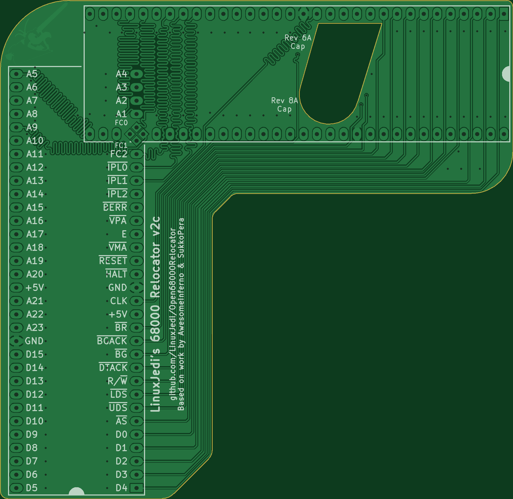
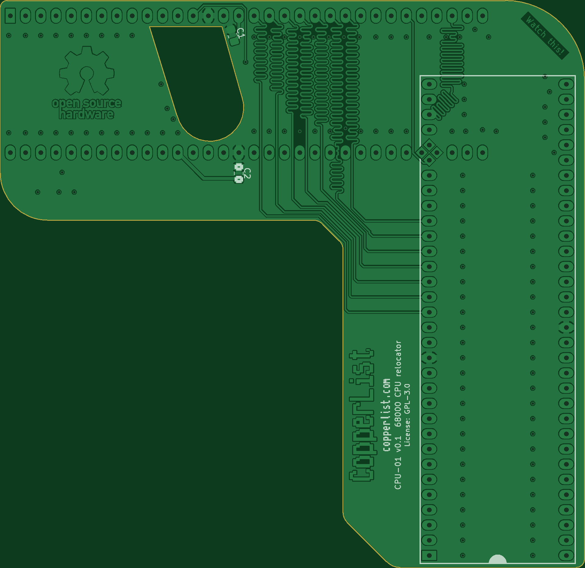

# CopperList CPU-01: Amiga 500 68000 CPU relocator

CPU-01 is CopperList's build of [LinuxJedi's Open68000Relocator](https://github.com/LinuxJedi/Open68000Relocator)
(v2c), which is itself based on [SukkoPera's Open68000Relocator](https://github.com/SukkoPera/Open68000Relocator).
It plugs into the Amiga 500's 68000 socket and turns the CPU 90 degrees, so accelerators such as the TF534 and
TF536 fit. The circuit, the 4-layer routing and LinuxJedi's markings are unchanged; the changes are listed below.

Like the original, CPU-01 is open hardware under the GNU GPL v3 (see [LICENSE](LICENSE)).

## Changes from LinuxJedi's v2c

1. **0805 capacitors.** C1 and C2 (100 nF decoupling, on the underside) use KiCad's 0805 hand-solder footprint
   instead of 0603, in the same places and on the same nets.
2. **Clear CPU outlines and pin-1 notches.**
   - Original CPU position (the pins that go into the motherboard socket): a full outline with a large filled
     pin-1 notch, on the underside (what you see when lining the board up with the socket) and on the top. On
     the top it stops where the relocated socket's outline starts.
   - Relocated socket (where the CPU goes): the outline is redrawn with a large filled notch, kept clear of the
     board edge so it is not trimmed. Upstream's notch was 2 mm across in a 0.12 mm line, half on the edge.
   - Outlines are 0.2 mm wide and kept clear of pads and text.
3. **Design-rule clean-up.** KiCad's DRC now reports nothing but the intended overlap of the two 64-pin
   footprints (also listed as an exclusion in the project):
   - A11's meander on In1.Cu had a 0.05 mm hump 0.13 mm from A8 (the board's rule is 0.15 mm). It is now
     straight, which makes A11 about 0.16 mm shorter (about 1 ps, negligible).
   - Four dead-end track stubs (D1, DTACK, BG, BERR, 0.2 to 1.1 mm long) are removed. No connection changes.
   - No silkscreen over pads.
4. **CopperList markings on the underside:** bare-copper CopperList wordmark, copperlist.com, part number and
   version (CPU-01 v0.1), and the licence. LinuxJedi's own text and logos on the top are kept.

The board file is now in KiCad 7 format (upstream was KiCad 6 / 5.99).

## Ordering (JLCPCB)

Files are in [`cpu01/jlc/`](cpu01/jlc): `CPU-01_v0.1_gerbers.zip`, plus `CPU-01_v0.1_BOM.csv` and
`CPU-01_v0.1_CPL.csv` if you want JLC to fit the two capacitors.

- 4 layers, **1.6 mm** thick. (The board file's stack-up says 4.69 mm; that is a leftover default, ignore it.)
- About 97.4 x 94.7 mm. Default capabilities are enough: 0.25 mm tracks, 0.15 mm clearance, 0.4 mm via drills.
- No impedance control needed.

## Parts

| Ref | Part | Notes |
| --- | --- | --- |
| C1, C2 | 100 nF 50 V X7R, 0805 | LCSC C49678 (JLC basic part). Underside. |
| U1 | 2 x 32 round machined (turned) pin strips, 0.9" row spacing | Underneath, into the motherboard's CPU socket |
| U2 | 64-pin 0.9" DIP socket, or 2 x 32 machined pin strips | On top, for the 68000 |

Holes for the pins are 0.8 mm.

## Building the files

`cpu01/build.sh` rebuilds everything from LinuxJedi's original board (`cpu01/upstream/68000Relocator.kicad_pcb`):
it applies the changes (`cpu01/tools/apply_cpu01.py`), runs DRC, exports Gerbers and drill files, writes the JLC
files and the previews. It needs KiCad 7 (kicad-cli and the pcbnew Python module, with KiCad's footprint
libraries), gerbv, and Python with shapely and Pillow.

---

# Upstream README (LinuxJedi's Open68000Relocator)
Open68000Relocator is an Open Hardware adapter PCB that changes the orientation of a 68000 DIP CPU.

**Note**: This project requires KiCad 5.99 or higher.

## Summary
This is based on [SukkoPera's](https://github.com/SukkoPera/Open68000Relocator) awesome 68000 relocator. I modified it to make it easier to fit on some motherboards and better support for PiStorm. It has the following changes:

* Hole for the capacitor C816 in rev 6 and 8 Amiga 500s (and Plus).
* Re-routed 4-layer with length adjusted traces for stability with PiStorm on some Amigas.
* Better power traces, useful for PiStorm.
* Some style changes.
* A couple of decoupling capacitors (2x 100nF 0603).

## License
Open68000Relocator is Open Hardware released under the GNU General Public License (GPL) v3. If you make any modifications to the board, **you must** contribute them back.

Open68000Relocator is provided to you ‘as is’ and without any express or implied warranties whatsoever with respect to its functionality, operability or use, including, without limitation, any implied warranties of merchantability, fitness for a particular purpose or infringement. We expressly disclaim any liability whatsoever for any direct, indirect, consequential, incidental or special damages, including, without limitation, lost revenues, lost profits, losses resulting from business interruption or loss of data, regardless of the form of action or legal theory under which the liability may be asserted, even if advised of the possibility or likelihood of such damages.

